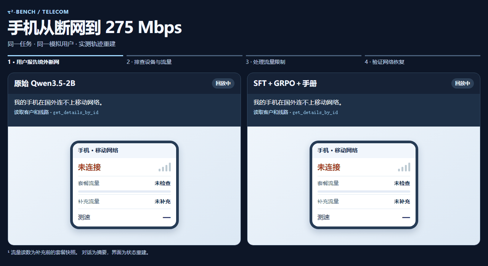
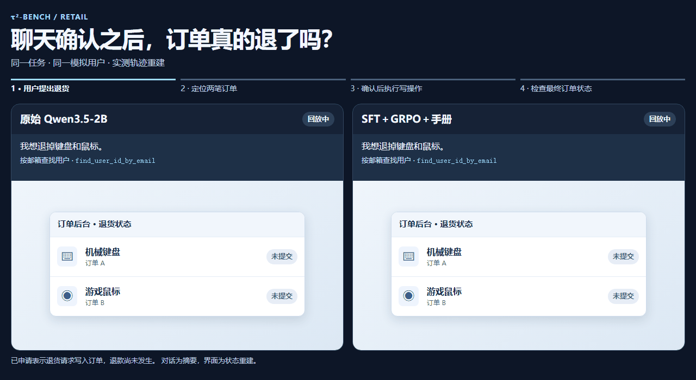
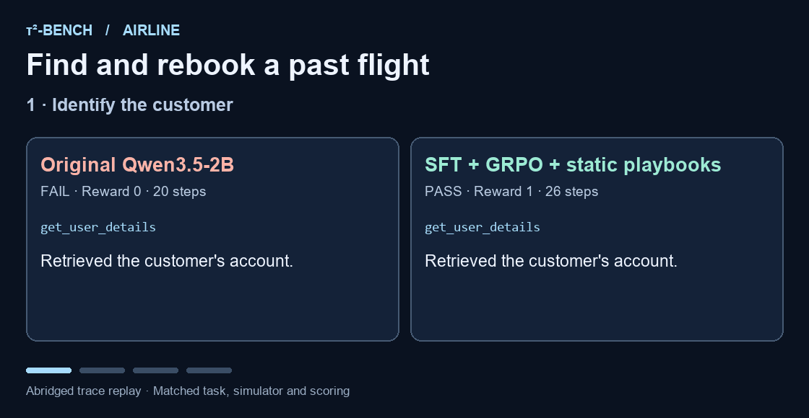

# 客服 Agent 后训练与轨迹回放

将 Qwen3.5-2B 用于 [τ²-bench](https://github.com/sierra-research/tau2-bench) 的电信、零售和航空多轮工具调用任务。项目使用通过官方评分的教师轨迹做 SFT 冷启动，在 VeRL 中做 GRPO 后训练，并在系统提示中加入分域静态业务手册。下面三组展示的是相同任务上原始模型失败、优化方案成功的实际轨迹。

[交互回放 HTML](demos/index.html) · [逐段证据与轨迹哈希](data/cases.json) · [完整两组评测汇总](data/metrics.json)

GitHub 会直接展示下面的 GIF。要切换步骤或暂停，下载 HTML 后用浏览器打开即可。也可单独下载各段 MP4。

## 三组失败与成功对照

| 同题任务 | 原始 Qwen3.5-2B · 0 分 | SFT＋GRPO＋手册 · 1 分 |
| --- | --- | --- |
| **Telecom** · 恢复漫游移动数据 | 反复排障，接近步数上限才检查流量，未补充流量 | 发现套餐流量超额，补充 2 GB，最终测速 275 Mbps |
| **Retail** · 任务 14，退两笔订单中的商品 | 查到了订单和商品，对话结束时没有写入退货请求 | 两次调用退货工具，两笔订单均进入 `return requested` |
| **Airline** · 任务 8，复订历史航班 | 反复搜索，未读取历史预订，未创建新订单 | 读取历史预订，匹配航班并为两位乘客完成订票 |

### Telecom · 恢复数据连接



[MP4](demos/telecom.mp4) · [静态总结](demos/telecom.png)

### Retail · 提交两笔退货



[MP4](demos/retail.mp4) · [静态总结](demos/retail.png)

### Airline · 复订历史航班



[MP4](demos/airline.mp4) · [静态总结](demos/airline.png)

## 配对评测

| 方案 | Telecom | Retail | Airline | 总通过率 | 三域等权分 |
| --- | ---: | ---: | ---: | ---: | ---: |
| 原始 Qwen3.5-2B | 46/122 | 33/63 | 7/16 | 86/201（42.79%） | 44.61% |
| SFT＋GRPO＋静态业务手册 | 48/122 | 36/63 | 7/16 | 91/201（45.27%） | 46.75% |
| 净变化 | +2 | +3 | 0 | **+5 题 / +2.49 pp** | **+2.13 pp** |

两个完整组使用同一批 201 道官方来源留出任务、同一个 Qwen3.5-27B GPTQ INT4 模拟用户、相同贪心解码设置、种子 300 和官方评分。两组有 24 个失败转成功和 19 个成功转失败。上面的三组是从成功翻转中挑出的案例，分别覆盖三个业务域。评测为单轮，按实测比较完整组；这组对照估计的是后训练与手册组合的增益。

## 工程实现

- 用 27B 教师生成轨迹并用官方评分筛选，2B 使用 VeRL＋LoRA 做 SFT 与普通 GRPO。另做 DAPO 动态采样对照。
- 按官方业务政策和成功轨迹提炼静态手册（[电信](playbooks/telecom.txt)、[零售](playbooks/retail.txt)、[航空](playbooks/airline.txt)），注入系统提示，引导身份核验、业务确认、提交写操作与结果复核。
- 2B 使用 BF16 推理。评测通过 vLLM 部署，记录官方奖励、结束原因、工具调用以及可比对的轨迹哈希。
- 回放按关键步骤摘编同轮实测记录，省略账户、地址和支付标识。工具返回和官方奖励详见 [案例数据](data/cases.json)。

## 本地运行

从仓库打开 `demos/index.html` 可离线浏览。修改案例后可以重新生成 GIF 和回放 HTML。生成 MP4 时传入 FFmpeg 路径。

```sh
python -m pip install Pillow
python tools/build_demos.py --ffmpeg ffmpeg
```

[训练与评测说明](docs/evaluation.md) · [MERA-Evolve](https://github.com/yh-yao/MERA-Evolve) · [KnowWhenToHandOff](https://github.com/JaspinXu/KnowWhenToHandOff)
