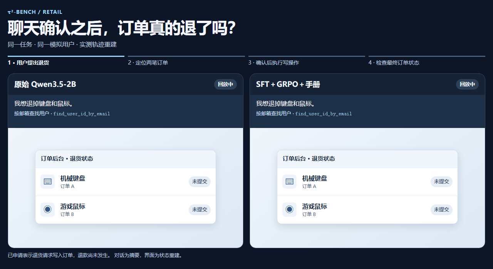
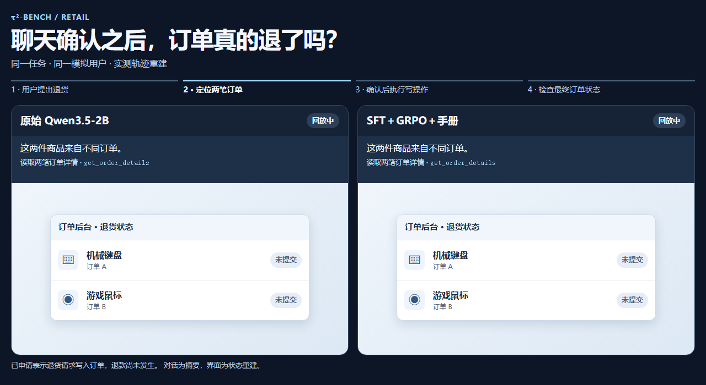
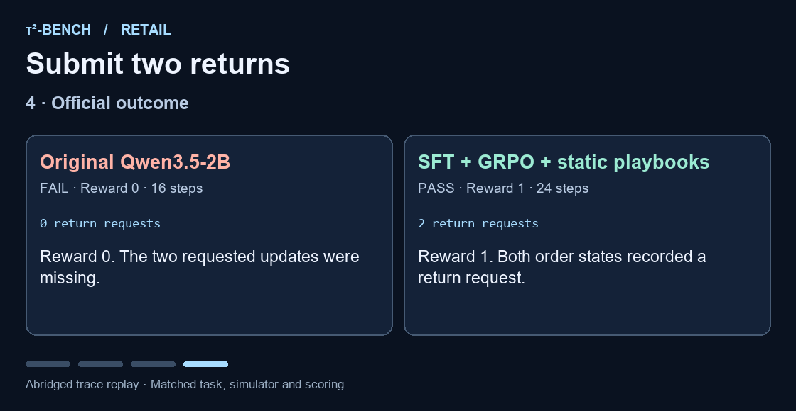
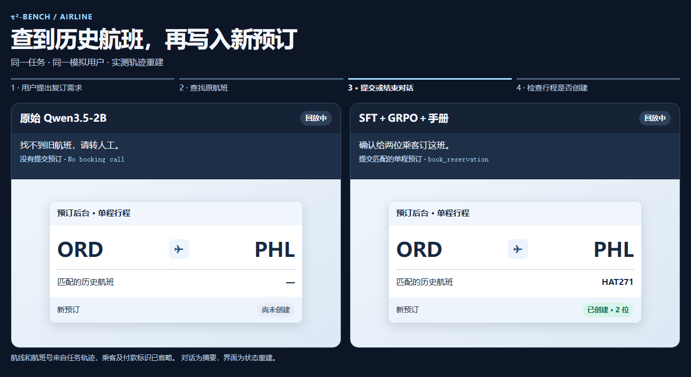

# 客服 Agent 后训练与轨迹回放

将 Qwen3.5-2B 用于 [τ²-bench](https://github.com/sierra-research/tau2-bench) 的电信、零售和航空多轮工具调用任务。项目使用通过官方评分的教师轨迹做 SFT 冷启动，在 VeRL 中做 GRPO 后训练，并在系统提示中加入分域静态业务手册。下面三组展示的是相同任务上原始模型失败、优化方案成功的实际轨迹。

每个案例在 README 里只显示一张图，点击对应的阶段可在同一个框里切换。画面按工具调用和返回结果重建，对话为摘要。

## 三组失败与成功对照

| 同题任务 | 原始 Qwen3.5-2B · 0 分 | SFT＋GRPO＋手册 · 1 分 |
| --- | --- | --- |
| **Telecom** · 恢复漫游移动数据 | 反复排障，接近步数上限才检查流量，未补充流量 | 发现套餐流量超额，补充 2 GB，最终测速 275 Mbps |
| **Retail** · 任务 14，退两笔订单中的商品 | 查到了订单和商品，对话结束时没有写入退货请求 | 两次调用退货工具，两笔订单均进入 `return requested` |
| **Airline** · 任务 8，复订历史航班 | 反复搜索，未读取历史预订，未创建新订单 | 读取历史预订，匹配航班并为两位乘客完成订票 |

### Telecom · 恢复数据连接

<table>
<tr><td>

第 1 张 · 1/4 · 用户报告境外断网

下一张 · 2/4 · 排查设备与流量

下一张 · 3/4 · 处理流量限制

下一张 · 4/4 · 验证网络恢复

</td></tr>
</table>

### Retail · 提交两笔退货

<table>
<tr><td>

第 1 张 · 1/4 · 用户提出退货

下一张 · 2/4 · 定位两笔订单

下一张 · 3/4 · 确认后执行写操作

下一张 · 4/4 · 检查最终订单状态

</td></tr>
</table>

### Airline · 复订历史航班

<table>
<tr><td>

第 1 张 · 1/4 · 用户提出复订需求

下一张 · 2/4 · 查找原航班

下一张 · 3/4 · 提交或结束对话

下一张 · 4/4 · 检查行程是否创建

</td></tr>
</table>

## 评测结果

| 模型 | Telecom | Retail | Airline | 总通过 | 三域等权平均 |
| --- | ---: | ---: | ---: | ---: | ---: |
| 原始 Qwen3.5-2B | 47/122 | 28/63 | 8/16 | 83/201 | 44.32% |
| SFT | 46/122 | 35/63 | 8/16 | 89/201 | 47.75% |
| SFT＋普通 GRPO | 50/122 | 37/63 | 8/16 | 95/201 | 49.90% |
| SFT＋DAPO 动态采样 | 47/122 | 37/63 | 7/16 | 91/201 | 47.00% |
| **SFT＋GRPO＋业务手册**（项目方数据） | **52/122** | **38/63** | **9/16** | **99/201** | **53.06%** |

## 工程实现

- 用 27B 教师生成轨迹并用官方评分筛选，2B 使用 VeRL＋LoRA 做 SFT 与普通 GRPO。另做 DAPO 动态采样对照。
- 按官方业务政策和成功轨迹提炼静态手册（[电信](playbooks/telecom.txt)、[零售](playbooks/retail.txt)、[航空](playbooks/airline.txt)），注入系统提示，引导身份核验、业务确认、提交写操作与结果复核。
- 2B 使用 BF16 推理。评测通过 vLLM 部署，记录官方奖励、结束原因、工具调用以及可比对的轨迹哈希。
- 回放按关键步骤摘编同轮轨迹，省略账户、地址和支付标识。

## 项目代码及部署

| 入口 | 作用 |
| --- | --- |
| [src/run_task.py](src/run_task.py) | 运行 τ²-bench 多轮工具交互，按业务域挂载可选手册 |
| [training/prepare_teacher.py](training/prepare_teacher.py) | 筛选通过官方评分的教师轨迹，保留客服可见的工具消息 |
| [training/train.sh](training/train.sh) · [合并 adapter](training/merge_adapter.py) | 调用 VeRL 入口进行 SFT 和普通 GRPO，导出可部署检查点 |
| [deploy/serve.sh](deploy/serve.sh) · [部署说明](deploy/README.md) | 用 vLLM 部署 2B 客服和 27B 模拟用户 |

[MERA-Evolve](https://github.com/yh-yao/MERA-Evolve) · [KnowWhenToHandOff](https://github.com/JaspinXu/KnowWhenToHandOff)
