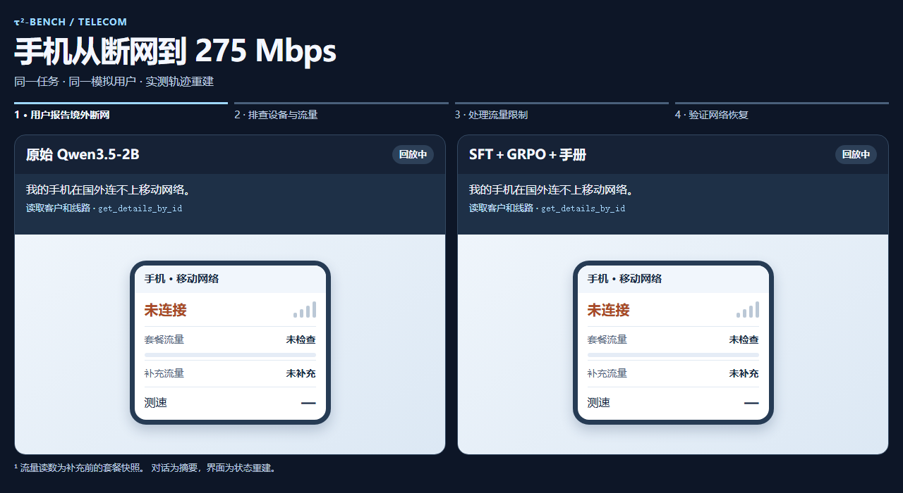
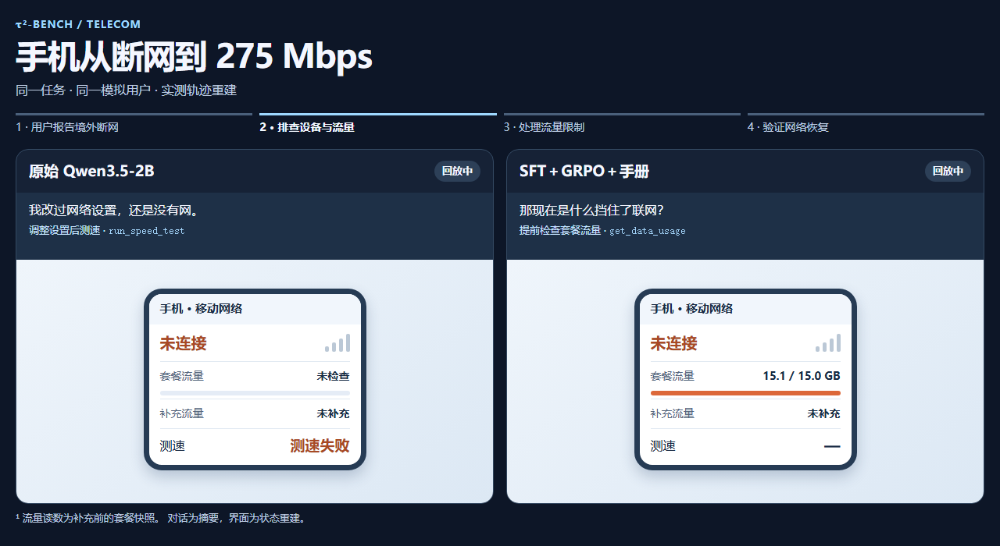
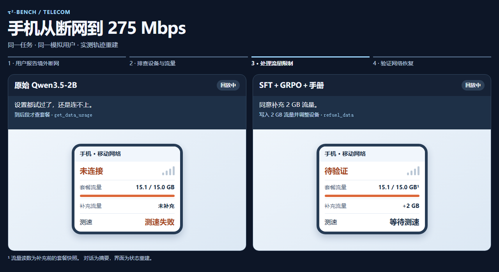
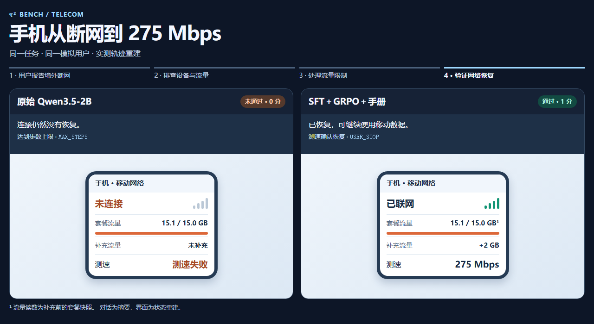
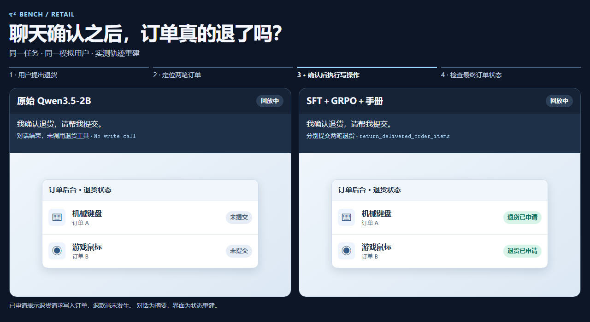
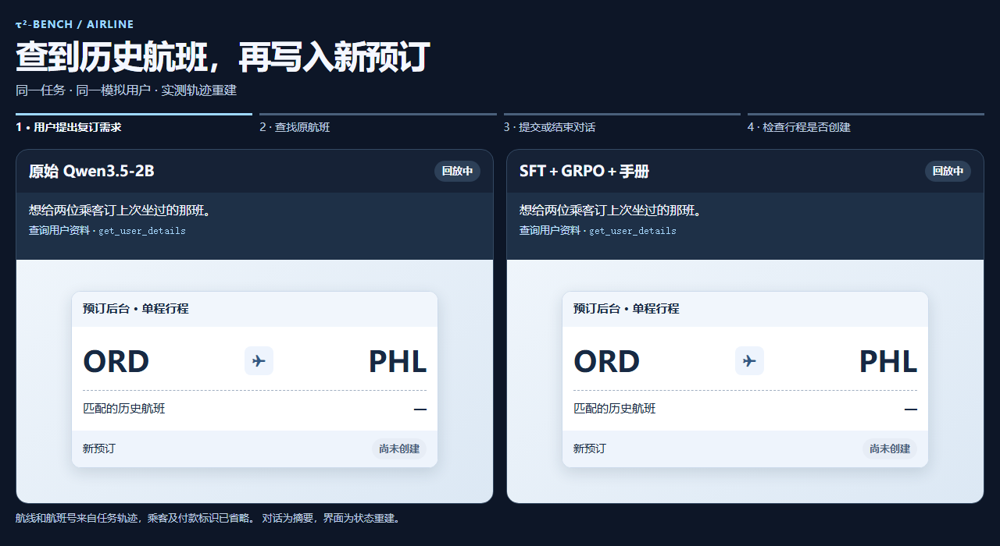
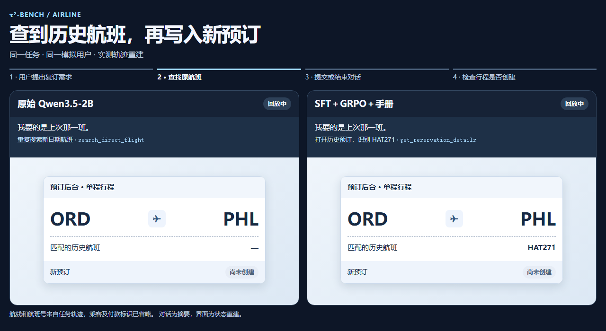
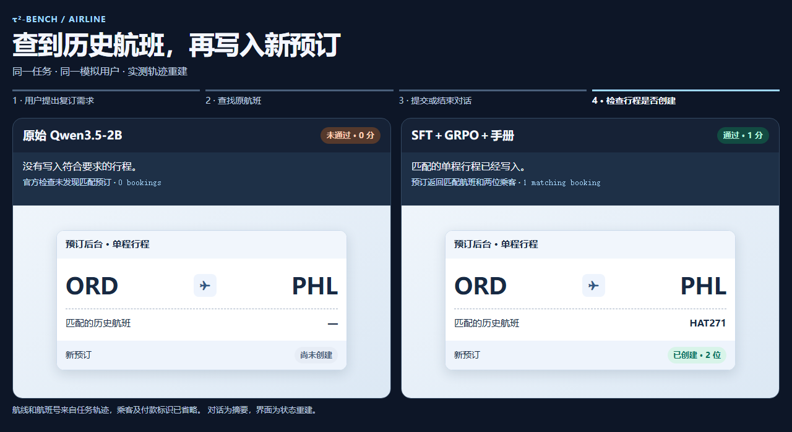

# 客服 Agent 后训练与轨迹回放

将 Qwen3.5-2B 用于 [τ²-bench](https://github.com/sierra-research/tau2-bench) 的电信、零售和航空多轮工具调用任务。项目使用通过官方评分的教师轨迹做 SFT 冷启动，在 VeRL 中做 GRPO 后训练，并在系统提示中加入分域静态业务手册。下面三组展示的是相同任务上原始模型失败、优化方案成功的实际轨迹。

[交互工作台 HTML](demos/index.html) · [逐段证据与轨迹哈希](data/cases.json) · [案例来源与评测口径](docs/evaluation.md)

每个案例先展示第一张对照图。直接在 README 点击图下方的「下一张」，即可逐张展开后续画面。画面按工具调用和返回结果重建，对话为摘要。

## 三组失败与成功对照

| 同题任务 | 原始 Qwen3.5-2B · 0 分 | SFT＋GRPO＋手册 · 1 分 |
| --- | --- | --- |
| **Telecom** · 恢复漫游移动数据 | 反复排障，接近步数上限才检查流量，未补充流量 | 发现套餐流量超额，补充 2 GB，最终测速 275 Mbps |
| **Retail** · 任务 14，退两笔订单中的商品 | 查到了订单和商品，对话结束时没有写入退货请求 | 两次调用退货工具，两笔订单均进入 `return requested` |
| **Airline** · 任务 8，复订历史航班 | 反复搜索，未读取历史预订，未创建新订单 | 读取历史预订，匹配航班并为两位乘客完成订票 |

### Telecom · 恢复数据连接



<details>
<summary>下一张 · 2/4</summary>



<details>
<summary>下一张 · 3/4</summary>



<details>
<summary>下一张 · 4/4（评测结果）</summary>



</details>
</details>
</details>

### Retail · 提交两笔退货


<details>
<summary>下一张 · 2/4</summary>


<details>
<summary>下一张 · 3/4</summary>



<details>
<summary>下一张 · 4/4（评测结果）</summary>


</details>
</details>
</details>

### Airline · 复订历史航班



<details>
<summary>下一张 · 2/4</summary>



<details>
<summary>下一张 · 3/4</summary>


<details>
<summary>下一张 · 4/4（评测结果）</summary>



</details>
</details>
</details>

## 评测结果

| 模型 | Telecom | Retail | Airline | 总通过 | 三域等权平均 |
| --- | ---: | ---: | ---: | ---: | ---: |
| 原始 Qwen3.5-2B | 47/122 | 28/63 | 8/16 | 83/201 | 44.32% |
| SFT | 46/122 | 35/63 | 8/16 | 89/201 | 47.75% |
| SFT＋普通 GRPO | 50/122 | 37/63 | 8/16 | 95/201 | 49.90% |
| SFT＋DAPO 动态采样 | 47/122 | 37/63 | 7/16 | 91/201 | 47.00% |
| **SFT＋GRPO＋业务手册** | **52/122** | **38/63** | **9/16** | **99/201** | **53.06%** |

前四行来自同一轮归档，手册组的分域计数由项目方提供。通过率采用三域等权平均。上方三个回放来自[另一次同配置对照](data/metrics.json)。

## 工程实现

- 用 27B 教师生成轨迹并用官方评分筛选，2B 使用 VeRL＋LoRA 做 SFT 与普通 GRPO。另做 DAPO 动态采样对照。
- 按官方业务政策和成功轨迹提炼静态手册（[电信](playbooks/telecom.txt)、[零售](playbooks/retail.txt)、[航空](playbooks/airline.txt)），注入系统提示，引导身份核验、业务确认、提交写操作与结果复核。
- 2B 使用 BF16 推理。评测通过 vLLM 部署，记录官方奖励、结束原因、工具调用以及可比对的轨迹哈希。
- 回放按关键步骤摘编同轮轨迹，省略账户、地址和支付标识。工具返回和官方奖励详见 [案例数据](data/cases.json)。

## 本地运行

下载 `demos/index.html` 后用浏览器打开，即可离线逐张查看。修改案例后可以重新生成 HTML。

```sh
python -m pip install Pillow
python tools/build_demos.py
```

更新 README 内的帧图时，运行 `python tools/build_demos.py --browser /path/to/chromium --readme-frames`。

[训练与评测说明](docs/evaluation.md) · [MERA-Evolve](https://github.com/yh-yao/MERA-Evolve) · [KnowWhenToHandOff](https://github.com/JaspinXu/KnowWhenToHandOff)
